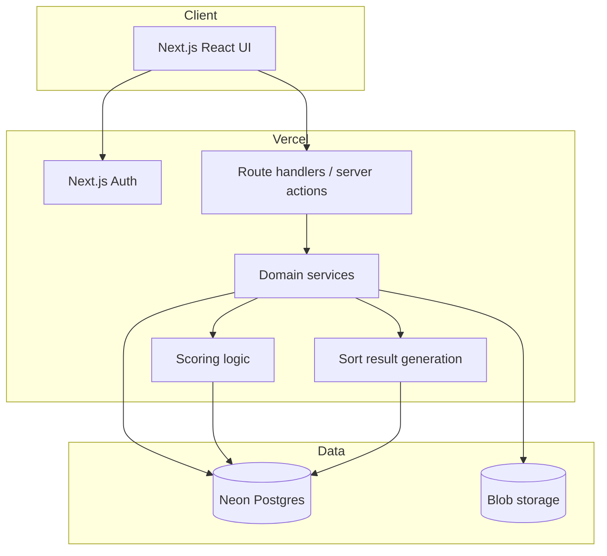

# PurseInator MVP App and Infrastructure Specification

## 1. Purpose

PurseInator is a private-first curatorial sorting application for physical collections.

The first implementation target is a handbag/purse collection, but the architecture should support other physical collections later. The system helps users photograph items, organize shared collection metadata, run private sorting sessions, and generate curated results that can optionally be shared.

The core product model is:

```text
Shared collection space
Private curator judgment
Explicit publication of results
```

## 2. MVP Product Principles

### 2.1 Shared objects, private judgment

Collections, items, photos, and factual metadata are shared among authorized collection members.

Sorting work is private to each curator unless explicitly shared. Private curator work includes:

- Sessions
- DecisionEvents
- Scores
- Preference state
- Draft SortResults
- Manual overrides
- Curator-specific judgment

A viewer of a shared result sees only the finalized output, not the raw decision history.

### 2.2 DecisionEvents are the source of truth

The primary historical record is the append-only `DecisionEvent`.

Scores, buckets, rankings, draft results, finalized results, and shortlist outputs are derived from DecisionEvents. Derived state may be recalculated.

### 2.3 Sessions are bounded work periods

A sorting session is not the whole collection sort. It is a time-boxed work period over a selected subset of items.

A curator may have one active session per collection.

### 2.4 Top-tier discovery matters most

The app does not need to fully rank all items. The MVP should prioritize:

- Finding and stabilizing the top tier
- Resolving top/high boundaries
- Resolving medium/low boundaries only when useful
- Avoiding excessive comparison fatigue

### 2.5 Tap-first, accessible interaction

The UI is tablet-first and tap-only. Avoid gestures that require precision, swiping, or dragging as primary interactions.

Use:

- Large tap targets
- Buttons instead of drag-only controls
- Clear progress indicators
- Low-pressure session pacing

## 3. Target Platform

### 3.1 Runtime

- Next.js
- React
- Vercel hosting
- Next.js Auth
- Neon Postgres
- Drizzle ORM
- Vercel Blob or compatible object/blob storage

### 3.2 Supported clients

The MVP is a responsive web application. No native apps.

Supported platforms:

- iPhone Safari
- iPad Safari
- Android Chrome
- Windows browsers
- macOS browsers
- Linux browsers

Photo upload must use standards-based browser upload behavior.

## 4. High-Level Architecture



## 5. Core Domain Model

### 5.1 User

Represents an authenticated application user.

Auth identity comes from Next.js Auth. The app stores its own `User` row for domain relationships.

Schema.org alignment: similar to `Person`.

### 5.2 Collection

A private container for items.

Each collection has one administrative owner. Ownership is administrative, not curatorial.

A collection may have multiple members with different capabilities.

### 5.3 CollectionMembership

Connects a user to a collection and defines capabilities.

Permissions live on membership, not on user.

Capabilities:

- `can_manage_collection`
- `can_invite_members`
- `can_add_items`
- `can_edit_metadata`
- `can_add_photos`
- `can_delete_photos`
- `can_sort`
- `can_view_outputs`

Roles such as Owner, Co-curator, Photographer, or Aficionado may be UI presets, but permissions are the source of truth.

### 5.4 Invitation

A targeted invitation to join a collection.

Invitations should be tied to an email address and accepted by an authenticated user. When accepted, an invitation creates a CollectionMembership.

### 5.5 Item

A canonical representation of one physical object in a collection.

Item metadata is shared factual data.

Suggested shared fields:

- `name`
- `brand`
- `style`
- `color`
- `material`
- `category`
- `status`
- `notes`

Schema.org alignment: similar to `Thing`, `Product`, or `IndividualProduct`.

### 5.6 Photo

A photo associated with an item.

The file lives in blob storage. The database stores metadata and references.

Schema.org alignment: similar to `ImageObject`.

### 5.7 Session

A bounded sorting work period for a curator within a collection.

A curator can have only one active session per collection.

Session goals may include:

- Quick triage
- Find favorites
- Compare top items
- Revisit undecided items

### 5.8 DecisionEvent

An immutable, append-only record of a curator judgment.

Supported MVP event types:

- `triage`
- `pairwise_compare`

Triage results use neutral internal buckets:

- `top`
- `high`
- `medium`
- `low`

Pairwise comparison results:

- `item_a`
- `item_b`
- `tie`
- `skip`

Schema.org alignment: similar to `Action`.

### 5.9 CollectionPreferenceItem

Derived curator-specific preference state for an item.

This is recalculated from DecisionEvents.

Contains:

- aggregate score
- confidence
- rank bucket
- comparison count
- last seen timestamp

### 5.10 SortResult

A reviewable snapshot generated from curator preference state.

SortResults may be:

- draft
- finalized
- shared

Draft results can be manually adjusted. Finalized results are frozen snapshots.

### 5.11 SortResultItem

An item inside a SortResult.

Stores both computed values and manual overrides.

Important rule:

```text
computed rank/bucket is preserved
manual rank/bucket is optional
final rank/bucket is resolved for display
```

### 5.12 SortResultShare

Explicit publication rule for a finalized SortResult.

Sharing exposes only the finalized result, not raw events or private decision history.

## 6. Primary User Workflows

### 6.1 Create a collection

```text
Sign in
Create collection
Become collection owner
Optionally invite collaborators
Land on collection dashboard
```

### 6.2 Photo-first item ingestion

```text
Open collection
Add photo
Upload or capture image
Create draft item
Edit factual metadata now or later
Mark item active when ready
```

Every uploaded photo should attach to an item. A draft item can function as the photo inbox.

### 6.3 Manage members

```text
Open Members
Invite user by email
Assign permission flags
Resend or revoke invitation
Update member permissions
Remove member if needed
```

### 6.4 Run a triage session

```text
Start sorting session
Choose goal, item scope, and timebox
View one item at a time
Tap top/high/medium/low
Write DecisionEvents
Pause, resume, complete, or abandon session
```

### 6.5 Run a comparison session

```text
Start or continue session
System selects meaningful pairs
Curator chooses item A, item B, tie, or skip
Write pairwise_compare DecisionEvents
Update preference state
```

Pair selection should prioritize:

- likely top items
- close scores
- top/high boundary
- medium/low boundary
- ambiguous confidence

### 6.6 Review results

```text
Generate draft SortResult
Review computed rank and bucket
View confidence summary
Optionally manually adjust
Finalize result
```

### 6.7 Manual re-rank

Manual re-ranking should not edit DecisionEvents or computed scores.

Manual changes are stored on SortResultItem as overrides.

Primary interactions should use buttons or move controls, not drag-only behavior.

### 6.8 Share finalized result

```text
Finalize SortResult
Choose private or shareable
Share with selected user or token
Viewer sees read-only finalized output
Viewer does not see raw decisions
```

## 7. MVP Screens

### 7.1 Authentication

- Sign in
- Magic link option if supported
- Create account

### 7.2 Collections

- My Collections
- Create Collection

### 7.3 Collection Home

- Collection Dashboard
- Summary counts
- Active session prompt
- Jump links to Items, Sort, Results, Members
- Recent activity, limited to visible/shared activity

### 7.4 Members

- Member list
- Permission flags
- Pending invitations
- Invite form
- Resend/revoke controls

### 7.5 Items

- Item Grid
- Item Detail
- Edit Metadata
- Add Photos

The item grid should show this curator's derived bucket, not a shared global bucket.

### 7.6 Sorting

- Session Setup
- Resume Session
- Triage
- Compare

Prefer a one-item-at-a-time triage screen for MVP. It optimizes considered judgment and reduces cognitive load.

### 7.7 Results

- Review Draft Result
- Manual Re-rank
- Finalize Result
- Shared Result View

## 8. Data Ownership and Visibility Rules

### 8.1 Shared collection data

Visible to authorized members:

- Collection metadata
- Item metadata
- Photos
- Member list, if permitted
- Invitations, if permitted

### 8.2 Private curator data

Visible only to the curator unless explicitly shared:

- Sessions
- DecisionEvents
- Preference state
- Draft results
- Manual overrides
- Unshared finalized results

### 8.3 Shared finalized results

Visible only through explicit share records or share tokens.

A shared result includes:

- result name
- curator display name
- finalized date
- finalized rank/bucket output
- item photos and factual metadata

A shared result excludes:

- DecisionEvents
- scoring internals
- session history
- private notes
- unshared drafts

## 9. Authorization Rules

All write operations must be authorized server-side.

Client-side permission checks are for UI convenience only and must not be trusted.

General rules:

- Collection owner can manage the collection.
- `can_manage_collection` can update collection administration where allowed.
- `can_invite_members` can create and manage invitations.
- `can_add_items` can create items.
- `can_edit_metadata` can update shared item fields.
- `can_add_photos` can upload photos.
- `can_delete_photos` can delete photos.
- `can_sort` can create sessions and DecisionEvents.
- `can_view_outputs` can view shared outputs available to that membership.
- Private curator artifacts require `user.id == curator_id` unless explicitly shared.

## 10. API Surface

The API is defined separately in `purseinator_mvp_api_spec.md`.

Main resource groups:

- Users
- Collections
- Members
- Invitations
- Items
- Photos
- Sessions
- DecisionEvents
- CollectionPreferenceState
- SortResults
- SortResultItems
- SortResultShares

## 11. Database Architecture

### 11.1 Database

Use Neon Postgres.

Use Drizzle ORM.

### 11.2 Suggested tables

```text
users
collections
collection_memberships
invitations

items
photos

sessions
decision_events

collection_preference_items

sort_results
sort_result_items
sort_result_shares
```

### 11.3 Important constraints

```text
One active session per curator per collection:
UNIQUE(collection_id, curator_id)
WHERE status = 'active'
```

```text
DecisionEvents:
append-only
no update
no delete
```

```text
SortResults:
drafts editable
finalized results immutable
```

```text
Collections:
owner_id required
private by default
```

### 11.4 Deletion model

Support:

- archive
- soft delete
- purge

Definitions:

```text
archive = hide from active lists, preserve data
delete = soft-delete, block normal use
purge = permanent delete, including dependent rows and blobs
```

Purge is owner-only and requires explicit confirmation.

## 12. Blob Storage

Use Vercel Blob or equivalent.

Store original uploaded images.

Photo records should include:

- blob key or URL
- original filename
- MIME type
- file size if available
- uploaded by
- uploaded timestamp
- hero flag

Thumbnails can be deferred unless needed for performance.

If thumbnails are added, store generated derivative metadata separately or as additional photo variants.

## 13. Scoring Model

The first scoring model should be simple and replaceable.

DecisionEvents are preserved so the scoring model can change later.

Suggested MVP approach:

- Triage assigns base score by bucket.
- Pairwise wins/losses adjust score.
- Confidence increases with repeated direct evidence.
- Ambiguous or close items are prioritized for comparison.
- Bucket assignment is derived from score thresholds.

Internal bucket names:

```text
top
high
medium
low
```

UI labels can vary by collection or product language.

Example purse labels:

```text
top = Love / Keep
high = Like
medium = Useful / Maybe
low = Release / Donate
```

## 14. Session Generation

The session generator should choose items based on goal and collection state.

Priorities:

1. Unseen items
2. Lightly judged items
3. Items near important boundaries
4. Items with close scores
5. Top-tier refinement
6. Items with low confidence

Avoid over-comparing items already confidently low.

## 15. Non-Goals for MVP

Do not implement in the first MVP unless explicitly scoped later:

- AI tagging
- Resale pricing
- Historical sale-price lookup
- Ontology/RDF/SHACL layer
- Public collections
- Live collaborative sorting
- Realtime presence
- Full ELO ranking
- Social feed
- Native mobile apps
- Analytics dashboards
- Recommendation engine

## 16. Repository Structure Recommendation

```text
purseinator/
  docs/
    architecture/
      app-and-infra-spec.md
      api-spec.md
      domain-model.md
      decisions.md
    wireframes/

  src/
    app/
      api/
      collections/
      items/
      sessions/
      results/

    components/
      ui/
      layout/
      forms/

    features/
      auth/
      collections/
      members/
      invitations/
      items/
      photos/
      sessions/
      decisions/
      scoring/
      results/
      sharing/

    lib/
      db/
      auth/
      permissions/
      blob/
      validation/

    server/
      services/
      repositories/
      policies/
```

## 17. Implementation Order

Recommended vertical build order:

1. Auth and user profile
2. Collections
3. Items
4. Photo upload
5. Session creation/resume
6. Triage DecisionEvents
7. Derived preference state
8. Draft SortResult
9. Manual re-rank
10. Finalize result
11. Members and permissions
12. Invitations
13. Sharing finalized results
14. Comparison sessions
15. Cleanup and purge tools

## 18. Handoff Notes for Agents

Do not collapse shared collection data and private curator judgment.

Do not store scores on Item.

Do not make SortResults the source of truth.

Do not make role names the authorization model.

Do not expose another curator's DecisionEvents through shared results.

Do not require drag-and-drop for core interactions.

Keep the first implementation boring:

- Next.js
- Neon Postgres
- Drizzle
- Vercel Blob
- Server-side authorization checks
- Append-only DecisionEvents
- Derived scoring

The most important product invariant is:

```text
Collections are shared.
Judgment is private.
Sharing is explicit.
```
