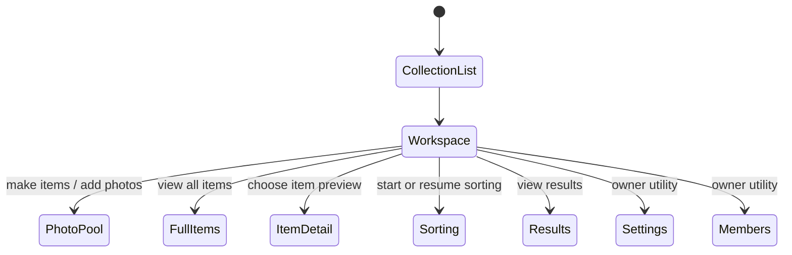

# Adaptive collection workspace - Implementation plan

> **For agentic workers:** Follow `CLAUDE.md`: use `superpowers:subagent-driven-development`, TDD within each task, adversarial review before merge, verification-before-completion, and Beads for task tracking. Spec: [`docs/superpowers/specs/2026-06-28-adaptive-collection-workspace-design.md`](../specs/2026-06-28-adaptive-collection-workspace-design.md). Bead: `purses-bee3`.

**Goal:** Turn `/collections/[id]` from a stats/dashboard hub into an adaptive collection workspace: pool-first when loose photos exist, item-preview-first otherwise, with sorting/results secondary and members/settings owner-only utilities. Keep `/collections/[id]/items` as the canonical full item grid.

**Tech stack:** Next.js App Router Server Components, TypeScript, Drizzle/Postgres, NextAuth, Vitest + Testing Library, Playwright.

## Review feedback folded into this plan

- Data/Persistence BLOCK: pool preview and item preview must be query-bounded, not UI-sliced from unbounded reads.
- Security/QA: owner utilities must use server-resolved permissions and have negative tests; UI hiding is not auth.
- Architect: `/items` remains canonical for full filter query state; no hash redirect.
- Craftsman: no extraction-only PR; extract only when the workspace creates a real second use.
- Graphic Design/UX: no operational filters in the workspace; use Luminous tokens, AA pairings, non-focusable thumbnails, and one dominant next action per adaptive state.

### Second adversarial review (folded; see spec §0b)

- **Bound via param, not new method:** add optional `limit`/`orderBy` to `findPoolByCollection` and `findByCollection`; reuse `findCoverPhotosByItemIds`. The bound is the SQL `LIMIT`, not a UI slice.
- **Order key:** pool `created_at ASC, id ASC`; items `number ASC`. DB tests seed distinct `created_at` so a `LIMIT` over ties is deterministic. Never order by `updated_at`.
- **Pool URL:** `getPoolPhotoAssetUrl(collectionId, photoId)` (the item builder throws for pool photos).
- **Owner check:** `isOwner = collection.ownerId === session.user.id`; query previews by the resolved `collection.id`.
- **Empty vs error:** failed preview queries propagate (page-level); only per-`` failures degrade. The inaccessible-collection test asserts the preview repo was *not* called.
- **One dominant action** per adaptive state (items-first too). Items grid carries warm "things gathered here" framing.
- **Simplicity:** only `PhotoPoolPreview`/`ItemPreviewGrid` are components; inline secondary/owner links. Task 1 drops dashboard-card polish (Task 4 deletes it); Task 3 folds into Task 2. Contrast rows only for pairings not already in `contrast.test.ts`.
- **Hygiene:** quote bracketed `[id]` test paths (zsh glob).

## Wireframes

### Pool-first workspace

```text
/collections/summer-bags

[Breadcrumbs] Collections / Summer bags

Summer bags                                      Collection settings
Created Jun 28, 2026                              Members

+ Photo pool ------------------------------------------------------+
| Photos waiting here                                             |
| These can become items whenever you're ready.                    |
|                                                                  |
| [thumb] [thumb] [thumb] [thumb]              [Make items]        |
|                                             [Add more photos]    |
+------------------------------------------------------------------+

Items                                                 View all items
Things gathered here

+----------+  +----------+  +----------+  +----------+
| photo    |  | photo    |  | photo    |  | photo    |
| Item     |  | Item     |  | Item     |  | Item     |
+----------+  +----------+  +----------+  +----------+

Continue
[Resume sorting]  Results
```

(`[bracketed]` = one dominant action; bare text = quiet secondary link.)

### Items-first workspace

```text
/collections/summer-bags

[Breadcrumbs] Collections / Summer bags

Summer bags                                      Collection settings
Created Jun 28, 2026                              Members

Items                                                  [Add photos]
Things gathered here                          Add item · View all items

+----------+  +----------+  +----------+  +----------+
| photo    |  | photo    |  | photo    |  | photo    |
| Item     |  | Item     |  | Item     |  | Item     |
+----------+  +----------+  +----------+  +----------+

Continue
[Start sorting]  Results
```

### Navigation map (page-to-page links, not app state; state = `WorkspaceState` union, Task 4)



## Global constraints

- `/collections/[id]/items` remains the canonical full grid and query-state owner.
- Workspace previews are bounded at the query layer via an optional `limit` on the existing repo methods (not new near-duplicate methods); queried by the resolved `collection.id`.
- `PhotoPoolPreview` is read-only. No selection, grouping, mutation, or local pool state.
- Owner utilities are shown only when `isOwner = collection.ownerId === session.user.id`. `/edit` and `/members` remain independently owner-gated by `requireCollectionOwnerPage`.
- Adaptive state is a derived discriminated union from preview row counts (one `Promise.all`, no count queries). Failed preview queries propagate; only per-`` failures degrade.
- New visual surfaces use Luminous tokens only. Add a `contrast.test.ts` row only for a pairing not already covered there.
- UI tests query by role/name/state, not snapshots; assert governed labels once, by role+name. DB tests live under `src/lib/db` (CI runs them via the inlined `RUN_DB_TESTS=1 npx vitest run src/lib/db`; `npm run test:db` is the Docker-based local equivalent).

## Task 1: (Dropped) standalone collection-home copy cleanup

Cut on second review (Craftsman). The old `stats`/`dashboardLinks` arrays - including `Finalized` and the emoji icons - are exactly what Task 4 deletes, so sentence-casing them first is throwaway work. Task 4 builds the new workspace surface with correct copy (the first-slice label inventory) from the start, so `Finalized` never survives. Durable `/items` label fixes (`Add Item` → `Add item`, softer `unnamed` wording) move to Task 5, where that page lives.

No standalone copy-only PR. If the old dashboard must coexist briefly behind a flag, fix its copy as part of Task 4, not here.

## Task 2: Query-bounded preview data paths (pool + items)

Both bounded reads land together (former Task 3 folded in - one concern: bound the reads).

**Files likely touched:** `src/server/repositories/PhotoRepository.ts`, `src/server/repositories/implementations/PhotoRepository.ts`, `src/server/repositories/ItemRepository.ts`, `src/server/repositories/implementations/ItemRepository.ts`, `src/server/api/photos.ts`, `src/server/api/items.ts`, `src/lib/db/*.integration.test.ts`, possibly `src/lib/db/schema.ts` and `drizzle/*.sql`.

1. Inspect current photo indexes in `src/lib/db/schema.ts`, `PhotoRepository.findPoolByCollection`, `ItemRepository.findByCollection`, and the existing `PhotoRepository.findCoverPhotosByItemIds`.
2. Write DB-backed failing tests under `src/lib/db/`:
   - **pool preview** (`findPoolByCollection(collectionId, 6)`): seed >6 pooled photos with **distinct `created_at`** (monotonic clock + per-row `UPDATE`, as the existing integration tests do), plus deleted, assigned, and other-collection photos. Assert: ≤6 when more exist, exactly 6 when exactly 6, fewer when fewer; deterministic `created_at ASC, id ASC` order; deleted/assigned/foreign each excluded (separate assertions); the previewed photo's URL uses `getPoolPhotoAssetUrl`.
   - **item preview** (`findByCollection(collectionId, { limit: 12, orderBy: number })`): assert only the slice is returned, in `number ASC` order, and that cover lookup reuses `findCoverPhotosByItemIds` for only the displayed IDs.
3. Implement as **optional params on the existing methods**, not new methods: add `limit?` (+ the `id` tiebreaker in the pool ordering) to `findPoolByCollection`; add `{ limit?, orderBy? }` to `findByCollection`. Existing callers pass nothing and keep current behavior.
4. Run `EXPLAIN` locally on the pool preview query. Expectation (state it in a comment): the bounded preview is cheaper than today's accepted unbounded pool read, so **no new index is needed**. Only if EXPLAIN disproves that, add a partial/composite index migration - and because the transactional migrator forecloses `CREATE INDEX CONCURRENTLY`, note the deploy-time lock in the migration.
5. Run the focused DB file, then `npm run test:db` (or the inlined `RUN_DB_TESTS=1 npx vitest run src/lib/db/<file>` if Docker is unavailable locally).

Acceptance:

- Neither preview can fetch the whole pool/collection; the bound is the SQL `LIMIT`.
- No new near-duplicate repo method; no new cover method.
- DB tests prove limit (incl. exact-6 boundary), filter, and deterministic order under distinct timestamps.
- Index decision (no index expected) is documented in a comment; any migration notes its lock.

## Task 3: (Folded into Task 2)

The item preview is the same concern as the pool preview - bound an existing read - so it ships in Task 2 (`findByCollection(collectionId, { limit: 12, orderBy: number })`, reusing `findCoverPhotosByItemIds`). `/collections/[id]/items` full-grid behavior stays unchanged.

## Task 4: Workspace components and adaptive rendering

**Files likely touched:** `src/app/collections/[id]/page.tsx`, new local components under `src/features/collections/` or `src/app/collections/[id]/`, route tests.

1. Write failing server-component tests for the adaptive states (assert on the resolved `WorkspaceState.kind`, not incidental DOM order):
   - `pool-first` with pool only;
   - `items-first` with items only, exposing exactly one dominant action (`Add photos`) and `Add item`/`View all items` as secondary;
   - `pool-first` with both, rendering `Photo pool` before `Items` and still rendering the item preview;
   - `empty`, with exactly one add-photos action.
2. Write failing tests for owner utility visibility and access gating:
   - owner (`collection.ownerId === session.user.id`) sees `Collection settings` and `Members`;
   - curator/non-owner does not;
   - inaccessible collection renders no workspace data **and** the preview repositories were not called (proves the §7 access-before-query invariant; a render-only check passes even when ungated).
3. Implement:
   - `PhotoPoolPreview` - read-only, decorative (`alt=""`) non-focusable images, section-level route action to `/pool`, neutral fallback node;
   - `ItemPreviewGrid` - minimal local component;
   - `Sorting`/`Results` and owner utilities as **inline** `<nav>` link blocks in the page (no `CollectionSecondaryActions`/`CollectionOwnerUtilities` components), owner block gated by `isOwner`, outside the `Continue` group;
   - resolve `WorkspaceState` once from the two preview results via `Promise.all`; let a failed preview query propagate (no `catch` to `[]`).
4. Use the spec's tokens. Add a `contrast.test.ts` row only if a pairing is not already covered there.
5. Run `npm run test:ci -- 'src/app/collections/[id]' src/features/collections src/lib/design` (quote the bracketed path - zsh treats `[id]` as a glob).

Acceptance:

- Adaptive rule proven by `kind` assertions; items-first has one dominant action.
- No status filters on the workspace.
- Owner utilities are inline, gated by `ownerId === userId`, not continuation actions.
- Thumbnail previews are not tab stops and expose no alt text.
- A failed preview query does not render as the empty state.

## Task 5: Keep `/items` canonical and clean touched labels

**Files likely touched:** `src/app/collections/[id]/items/page.tsx`, `src/features/items/ItemFilters.tsx`, tests.

1. Add/adjust tests proving `/collections/[id]/items` still owns `status`/`unnamed` query state. Assert the durable label fixes once, by role + accessible name (not snapshot copy): `Add Item` → `Add item`, softer unnamed wording (`Waiting for a name` / `Needs a name`). These are the durable labels formerly in Task 1.
2. Update touched labels to sentence case and softer wording where practical.
3. Do not redirect `/items`.
4. Run `npm run test:ci -- 'src/app/collections/[id]/items' src/features/items` (quote the bracketed path).

Acceptance:

- Full item grid still works.
- Query filters still work.
- The workspace links to `/items` for full browsing.
- Durable `/items` labels are sentence case, asserted once by role+name.

## Task 6: Playwright coverage and screenshots

**Files likely touched:** `e2e/adaptive-collection-workspace.spec.ts`, `e2e/fixtures/seed.ts`, `e2e/screenshots/capture.ts`.

1. Add seed support for:
   - pool-only;
   - items-only;
   - both;
   - empty collection.
2. Write e2e:
   - pool-first links to `/pool`;
   - both state renders pool before items;
   - items-first links to `/items`;
   - empty state offers one add-photos action;
   - keyboard traversal reaches header, primary section, secondary actions, owner utilities in order.
3. Add screenshot surfaces for pool-first and items-first in light and dark.
4. Run `npx playwright test e2e/adaptive-collection-workspace.spec.ts`.
5. Run `npm run screenshots` when preparing the PR.

Acceptance:

- Browser flow proves adaptive states.
- Screenshots exist for UI review.
- E2E lives under `e2e/**` so the CI `e2e` job picks it up.

## Task 7: Optional collection-list pool cue

Do this only after the workspace lands and only if the owner still wants it.

1. Add a query-bounded, access-scoped pool cue method for accessible collection IDs.
2. Add DB-backed leakage tests: inaccessible collection pool state never appears.
3. Add a small collection-card cue such as `Photos waiting`.
4. Run unit, DB, and e2e as applicable.

Acceptance:

- No global pool.
- No unbounded query.
- No cross-collection pool-state leak.

## Definition of done

- Spec review folds are represented in code and tests.
- `npm run build`, `npm run test:ci`, `npm run lint`, `npm run auth:verify` green.
- `npm run test:db` green (Task 2 changes repository methods).
- Focused Playwright spec green; full e2e as practical before PR.
- `graphify update .` after code changes.
- `/sync-docs` before pushing/opening PR.
- UI PR includes light/dark screenshots.
- Whole-branch adversarial review runs before merge.
