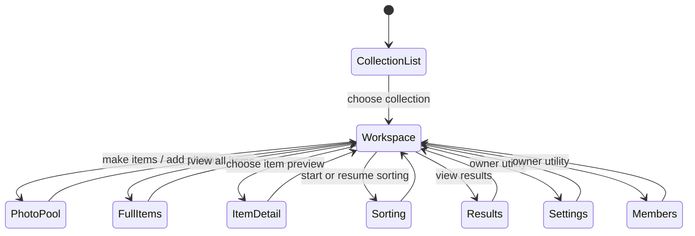

# Adaptive collection workspace - Design spec

**Date:** 2026-06-28
**Status:** Second adversarial review applied (HIGH/MED/LOW folds) - ready for planning
**Author:** Codex planning session
**Bead:** purses-bee3
**Governing authorities, in order:** [`TONE.md`](../../../TONE.md) first-order -> [`PRODUCT.md`](../../../PRODUCT.md) -> [`DESIGN.md`](../../../DESIGN.md). Wireframes are reference, not law.

## 0. Review folds

A full 7-persona adversarial spec review (QA/Test, Security, Architect, Craftsman, Data/Persistence, Graphic Design, UX) ran against the draft. Verdict before folds: **BLOCK** from Data/Persistence plus CONCERNS from the other lenses. Material folds:

- **[BLOCK -> fixed] Pool preview was only UI-bounded.** The workspace requires a query-bounded preview path with SQL `LIMIT`, deterministic ordering, and DB-backed proof. *(Superseded by §0b: the bound is satisfied by a `limit` param on the existing `findPoolByCollection`, not a new method - the forbid-reuse and selected-columns clauses were over-correction. The query-layer bound stands.)*
- **[MED -> fixed] "No schema change expected" was premature.** The first implementation slice must make an index/EXPLAIN decision for the new pool preview query. If existing indexes are not enough, the slice includes the additive index migration.
- **[MED -> fixed] Full item reads on the primary workspace were unbounded.** The workspace now uses a bounded initial item preview. `/collections/[id]/items` remains the full item route for this effort.
- **[HIGH -> fixed] CI placement was implicit.** Tests now name the CI tier: `npm run test:ci`, `npm run test:db`/`db-tests`, and Playwright `e2e`.
- **[HIGH -> fixed] Access boundaries lacked negative proof.** The spec now requires non-member, curator/non-owner, and owner cases for data visibility and owner-only action visibility.
- **[MED -> fixed] Items route/query ownership was undefined.** `/collections/[id]/items` remains the canonical full item-grid URL and owns `status`/`unnamed` query state. No redirect/hash consolidation in this effort.
- **[MED -> fixed] `ItemsSection` extraction was abstraction-first.** Extract only at the point of real reuse and only the minimum component surface needed; no extraction-only PR.
- **[MED -> fixed] Pool preview risked becoming a second pool UI.** The workspace preview is read-only: thumbnails plus a route action, no grouping, selection, or mutation.
- **[MED -> fixed] Item filters preserved inventory/status framing.** The workspace avoids status filter pills. The full `/items` route may retain operational filters, but touched labels move toward person-side sentence case.
- **[MED -> fixed] Token/theme acceptance was underspecified.** New surfaces must use Luminous tokens and AA-verified foreground/background pairs in both themes.
- **[MED -> fixed] Members/settings IA drift.** `Members` is an owner utility, not a peer continuation action. It sits with owner utilities or in settings, not beside `Sorting`/`Results`.
- **[MED -> fixed] Pool-first state had competing primary actions.** Each adaptive state has one dominant next action. When loose photos exist, the dominant action is to go to the pool to make items; `Add item` does not compete.
- **[MED -> fixed] Thumbnail semantics were ambiguous.** Preview thumbnails are non-focusable images; the section-level link/button owns the route action.
- **[LOW -> fixed] Loading/error requirements were vague for server-rendered pages.** The first implementation does not require section-level Suspense. Missing thumbnails degrade locally; fatal data errors remain page-level until a route hardening pass.

## 0b. Second adversarial review folds (2026-06-28)

A second 6-persona review (Data/Persistence, Architect, Security, QA/Test, Craftsman, UX+Graphic Design) ran against the revised spec. Security returned CLEAN; the rest CONCERNS, converging on an ordering defect. Folds applied:

- **[HIGH] Order key was wrong and had no tiebreaker.** The pool preview ordered by `updated_at` (bumped on photo rotation per `src/lib/photos.ts` - not stable, and disagrees with `/pool`'s `created_at ASC`). Both previews now order with a unique tiebreaker: pool `created_at ASC, id ASC`; items `number ASC`. DB tests seed distinct timestamps so a `LIMIT` over ties is deterministic. See §7, §13.
- **[HIGH] Pool-photo URL contract was modeled on the item path.** The item URL builder (`getPhotoAssetUrlForPhoto`) throws for pool photos (`item_id IS NULL`). The preview uses `getPoolPhotoAssetUrl(collectionId, photoId)`; column list corrected; pool-thumbnail fallback defined. See §7, §8.
- **[HIGH] "Capability state" was not a page-layer concept.** The capability machinery returns `NextResponse` and is API-only. Owner-utility visibility derives from `isOwner = collection.ownerId === session.user.id` (exactly how `requireCollectionOwnerPage` decides owner). See §4, §12.
- **[HIGH] Items-first reintroduced competing primaries** - the defect the first-round fold claimed to close, applied only to pool-first. Each adaptive state now has exactly one dominant action; items-first leads with `Add photos`, demoting `Add item`/`View all items` to quiet links. See §5, §6.
- **[HIGH] The "reachable only after access" invariant had no test.** The inaccessible-collection server-component test now asserts the preview repository was not called. See §13.
- **[MED] Reuse over rebuild** (reverses the first-round "forbid reuse" fold). A bounded query is satisfied by an optional `limit`/`orderBy` param on the existing `findPoolByCollection` / `findByCollection`, not a near-duplicate method - the original BLOCK was about UI-slicing an unbounded read, which a DB `LIMIT` prevents identically. Cover lookup reuses the existing N+1-safe `findCoverPhotosByItemIds`. See §7, §8.
- **[MED] Empty vs error boundary.** Preview query failures propagate (page-level); only per-`` load failures degrade to the calm fallback. A failed query must never render as the benign empty state. See §3, §8.
- **[MED] Migration locking.** EXPLAIN evidence suggests no new index is needed (the bounded preview is strictly cheaper than today's accepted unbounded pool read). If one is added, the transactional migrator forecloses `CREATE INDEX CONCURRENTLY`; the deploy-time lock must be acknowledged. See §7, §12.
- **[MED] Label tests were snapshot-style** (contradicting §11). Assert sentence-casing once, by role + accessible name, on a governed allowlist - not exact-copy snapshots at every layer. See §11, §13.
- **[MED] Items grid lacked the warm framing §3 promised.** The Items section carries person-side framing ("things gathered here"), not a bare utility header; reconsider the manufacturing verb "Make items". See §3, §9.
- **[MED] Simplicity.** `CollectionSecondaryActions`/`CollectionOwnerUtilities` are single-use 2-link blocks - inline them. Only `PhotoPoolPreview` and `ItemPreviewGrid` are components. Task 1 no longer polishes the dashboard Task 4 deletes; Task 3 folds into Task 2. See §8, plan.
- **[MED] Contrast rows.** Add a `contrast.test.ts` row only for a pairing not already covered there - new components reuse already-proven pairings. See §10.
- **[LOW] Adaptive state from preview rows.** Derive existence from preview `.length` in one `Promise.all`; no separate count queries. Model state as a discriminated union. See §8.
- **[LOW] Boundary tests.** Add exactly-6 and fewer-than-6 cases, not only `>6`. See §13.
- **[LOW] Thumbnail alt.** Preview images are decorative (`alt=""`); the section-level link carries the accessible name. See §11.
- **[LOW] Plan hygiene.** Quote bracketed `[id]` test paths (zsh glob expansion can run zero tests green); correct the CI DB-test mechanism description. See §13, plan.

## 1. Purpose

The current collection detail page is mostly a hub: metadata, three stat cards, an active-session panel, and a grid of equal destination cards. That makes the page navigable, but not useful enough as the collection's home.

The adaptive collection workspace makes `/collections/[id]` the place where a person can see the collection's real material and choose the next gentle action. The goal is not an inventory dashboard. The goal is a calm workspace that surfaces loose photos and items while keeping sorting, results, members, and settings clearly secondary.

## 2. Source context

Current surfaces:

- `/collections` lists named collections through `CollectionCard`.
- `/collections/[id]` renders stats and dashboard links in `src/app/collections/[id]/page.tsx`.
- `/collections/[id]/pool` owns loose photos, upload, selection, and grouping.
- `/collections/[id]/items` owns the full item grid and item filters.
- `/collections/[id]/sort` owns sessions.
- `/collections/[id]/results` owns result history.
- `/collections/[id]/edit` owns collection details and delete.
- `/collections/[id]/members` owns member management and is owner-gated.

The pain in `docs/UX_rework.md` is valid: the image pool is too hard to find, the collection home should show collection material, and the current stats/dashboard cards feel weaker than a modern entity workspace.

## 3. Product decision

`/collections/[id]` becomes the adaptive collection workspace.

Adaptive rule:

1. If the collection has loose pool photos, lead with a **Photo pool** preview.
2. If the collection has items, show a bounded **Items** preview on the same page.
3. If both exist, show pool first and items second.
4. If neither exists, show one gentle empty state that starts with adding photos.

Adaptive state is derived from the bounded preview results themselves (`poolPreview.length > 0`, `itemPreview.length > 0`), not from separate count queries. The "neither exists" empty state is reached only on a *successful* empty result. A preview query that throws must propagate to the page-level error boundary, never be caught into `[]` - a failed query rendering as the benign empty state is a silent failure.

The page can show item/photo grids. The tone risk is not the existence of a grid; the risk is making the grid feel like stock management or a pressure dashboard. Both grids must carry person-side framing - "photos waiting here" for the pool and "things gathered here" for items - not "inventory", "remaining", or "manage all". The warm framing applies to the Items section too: it does not ship as a bare utility header.

The primary workspace is not required to show every item. `/collections/[id]/items` remains the canonical full item-grid route.

## 4. Route ownership

### `/collections`

Keep this page focused on named collections. Do not add a global pool unless the product creates a real cross-collection inbox later.

An optional collection-card cue can mention that photos are waiting only if it is cheap, scoped, and query-bounded. If that cue needs new data access, it is a separate slice after the workspace lands.

### `/collections/[id]`

This is the primary workspace.

Remove or collapse:

- the separate stat-card row;
- the generic dashboard-card grid;
- emoji icons;
- "Manage ..." descriptions.

Add:

- a header with collection name, description, created date, and owner-only utility actions;
- an adaptive read-only `Photo pool` preview when pool photos exist;
- a bounded `Items` preview when items exist;
- secondary `Sorting` and `Results` actions;
- owner-only `Members` and `Collection settings` utilities outside the main `Continue` path.

### `/collections/[id]/pool`

Keep this route as the full pool/upload/grouping surface. The workspace links to it. Do not duplicate selection or grouping behavior in the workspace preview.

### `/collections/[id]/items`

Keep this route as the canonical full item-grid URL for this effort. It owns query-string filter state: `/collections/[id]/items?status=...&unnamed=1`.

The workspace may share a small item-card grid component if that avoids real duplication during implementation. Do not extract a full generic `ItemsSection` before the second use exists. Do not redirect `/items` to `#items` in this effort.

### `/collections/[id]/edit` and `/collections/[id]/members`

Do not hide settings in the breadcrumb. Breadcrumbs orient location; they do not carry admin actions.

For the first slice, both `Collection settings` and `Members` are owner-only utilities, shown only when `isOwner = collection.ownerId === session.user.id` (the same check `requireCollectionOwnerPage` makes - not the API-only capability machinery, which is unusable in a server component). The `/edit` and `/members` pages remain independent server-side enforcement boundaries through `requireCollectionOwnerPage`; UI hiding is not authorization.

## 5. Information architecture

Primary content:

1. Photo pool, when photos are waiting.
2. Items preview.

Primary next action by adaptive state:

- Pool photos exist: the one dominant action is `Make items from photos` / go to `/pool`. `Add item` does not compete.
- No pool photos, items exist: the one dominant action is `Add photos`. `Add item` and `View all items` are present as quiet, visibly secondary links - not peer primaries. (This mirrors the pool-first single-dominant-action rule; do not ship three equal-weight header actions.)
- Neither exists: the one dominant action is `Add photos`.

Secondary collection work:

1. Sorting.
2. Results.

Owner utilities:

1. Collection settings.
2. Members.

Avoid presenting all destinations as equal cards. The workspace should say: "Here is the collection; these are the next gentle actions."

## 6. Wireframes

### Collection list

```text
/collections

[Header]

Your collections                         [New collection]
The things you're deciding about, gathered in one calm place.

[Filters]

+----------------------+  +----------------------+
| cover photo          |  | cover photo          |
| Summer bags          |  | Winter keepsakes     |
| Photos waiting       |  |                      |
+----------------------+  +----------------------+
```

### Adaptive collection workspace: pool first

```text
/collections/summer-bags

[Breadcrumbs] Collections / Summer bags

Summer bags                                      Collection settings
Created Jun 28, 2026                              Members

+ Photo pool ------------------------------------------------------+
| Photos waiting here                                             |
| These can become items whenever you're ready.                    |
|                                                                  |
| [thumb] [thumb] [thumb] [thumb]              [Make items]        |
|                                             [Add more photos]    |
+------------------------------------------------------------------+

Items                                                 View all items
Things gathered here

+----------+  +----------+  +----------+  +----------+
| photo    |  | photo    |  | photo    |  | photo    |
| Item     |  | Item     |  | Item     |  | Item     |
+----------+  +----------+  +----------+  +----------+

Continue
[Resume sorting]  Results
```

(`[bracketed]` = one dominant action; bare text = quiet secondary link.)

### Adaptive collection workspace: items first

```text
/collections/summer-bags

[Breadcrumbs] Collections / Summer bags

Summer bags                                      Collection settings
Created Jun 28, 2026                              Members

Items                                                  [Add photos]
Things gathered here                          Add item · View all items

+----------+  +----------+  +----------+  +----------+
| photo    |  | photo    |  | photo    |  | photo    |
| Item     |  | Item     |  | Item     |  | Item     |
+----------+  +----------+  +----------+  +----------+

Continue
[Start sorting]  Results
```

### Empty collection

```text
/collections/new-collection

[Breadcrumbs] Collections / New collection

New collection                                   Collection settings

+------------------------------------------------------------------+
| Add photos when you're ready                                     |
| Photos can wait here until you are ready to name or group them.  |
|                                                                  |
|                                      [Add photos]                 |
+------------------------------------------------------------------+
```

### Navigation map

This is page-to-page navigation, not application state. The adaptive *state* is the `WorkspaceState` discriminated union in §8.



## 7. Data/query contracts

### Pool preview

The bound must live at the query layer (SQL `LIMIT`), never a UI slice of an unbounded read. Satisfy that by adding an optional `limit` parameter to the existing `findPoolByCollection`, not a near-duplicate method - the preview caller passes `findPoolByCollection(collection.id, 6)`; existing callers pass nothing and keep today's behavior. (This supersedes the first-round "forbid reuse" fold: a DB `LIMIT` the caller opts into prevents the UI-slicing the BLOCK was about, with one method instead of two.)

Required query shape:

- collection-scoped after `requireCollectionAccess`, queried by the **resolved `collection.id`** (never the raw URL param);
- `item_id IS NULL`;
- `deleted_at IS NULL`;
- deterministic order with a unique tiebreaker: `created_at ASC, id ASC` (matches `/pool`'s oldest-first order, so the preview's first 6 are the same 6 the destination shows; `id` breaks `created_at` ties so a `LIMIT` is stable). Do **not** order by `updated_at` - rotation bumps it, which would reshuffle "newest";
- `limit: 6` at the call site;
- the full `Photo` row is fine at 6 rows; build the thumbnail URL with `getPoolPhotoAssetUrl(collectionId, photoId)` (needs only `id` + `collectionId`). Do **not** use `getPhotoAssetUrlForPhoto` - it throws for pool photos (`item_id IS NULL`);
- no blob/file fetch during render (URL strings only; bytes stream from the guarded `/file` route).

Index/EXPLAIN decision (make it now, do not just defer): the existing single-column `photos_collection_id_idx` backs the filter; the `ORDER BY ... LIMIT 6` adds a small sort. The bounded preview is strictly cheaper than today's *accepted* unbounded `findPoolByCollection`, so **no new index is expected to be needed**. Confirm with a local `EXPLAIN`. If one is nonetheless added, note that the transactional migrator (`scripts/migrate.ts`) forecloses `CREATE INDEX CONCURRENTLY`, so it ships as a deploy-time lock-taking `CREATE INDEX` - acceptable on the small `photos` table, but state it in the migration.

DB-backed tests are required:

- returns at most 6 when more exist, exactly 6 when exactly 6 (off-by-one), and N when fewer than 6;
- ordering is deterministic - seed rows with **distinct** `created_at` (the existing integration tests use a monotonic clock + per-row `UPDATE` for exactly this reason) so the `LIMIT` cut is stable;
- deleted, assigned (`item_id` set), and other-collection photos are each excluded (three distinct assertions);
- the URL built for a previewed photo uses the pool builder and is well-formed.

The "only reachable after collection access succeeds" invariant is proven at the page/server-component layer (see §13), not by the repository test.

### Items preview and full items route

`/collections/[id]` owns a bounded item preview. `/collections/[id]/items` owns the full item route and its filter query state.

Required workspace item behavior:

- fetch only the preview slice, via an optional `{ limit, orderBy }` param on the existing `findByCollection` (not a new method); default `limit: 12`;
- deterministic order by `number ASC` - it is index-backed (`items_collection_number_unique (collectionId, number)`) and unique, so no tiebreaker is needed. Note `findByCollection` is currently unordered; the preview must pass an explicit order, and the full `/items` grid's ordering is unchanged in this effort;
- batch cover lookup for only the displayed item IDs by **reusing** the existing `findCoverPhotosByItemIds` (already one query, no N+1) - do not add a new cover method;
- show `View all items` linking to `/collections/[id]/items`;
- do not show operational status filters on the workspace.

Required `/items` behavior:

- retain the canonical filter URL shape for this effort;
- update touched labels to sentence case and softer wording where possible, for example `Waiting for a name` / `Needs a name`;
- keep full filtering behavior there until a later route consolidation spec.

## 8. Component shape

Prefer local, boring server-rendered components over broad abstractions. Only two earn a file:

- `PhotoPoolPreview` - real markup, plausible second use.
- `ItemPreviewGrid` - same.

The secondary actions (`Sorting`/`Results`) and owner utilities (`Collection settings`/`Members`) are single-use 2-link blocks; render them inline in the page (`<nav>` of links gated by `isOwner`), not as `CollectionSecondaryActions`/`CollectionOwnerUtilities` components. Extract only at the point of real reuse. An extraction-only PR is explicitly out of scope.

Adaptive state is a derived discriminated union computed once from the two preview row counts, so the pool-before-items precedence lives in one place rather than re-derived in JSX:

```ts
type WorkspaceState =
  | { kind: "pool-first" }   // pool has rows (items optional, shown second)
  | { kind: "items-first" }  // no pool rows, items has rows
  | { kind: "empty" }        // neither
```

Run the two previews in a single `Promise.all`; derive `kind` from `.length`. No separate count/existence queries.

`PhotoPoolPreview`:

- read-only;
- 4 to 6 preview images, non-focusable and decorative (`alt=""`); the section-level link carries the accessible name (see §11);
- one primary route action to `/pool`;
- optional secondary route action to `/pool` for adding more photos;
- no grouping, selection, mutation, or local pool state;
- no urgent count;
- a missing image URL degrades to a calm fallback node (the pool thumbnail has no item initial like `ItemCard`, so the fallback is a neutral placeholder, not a letter).

The first implementation is server-rendered with direct awaits. Do not add section-level Suspense unless the implementation actually introduces async section streaming. A failed preview *query* propagates to the page-level error boundary (a real failure must not be caught into `[]` and rendered as the empty state); only a per-`` load failure degrades to the calm fallback. Route-level error hardening is otherwise deferred.

## 9. Copy and casing

Use sentence case across touched surfaces.

Both grids carry a short person-side framing line under the section heading so the short action verbs can stay short and scannable while the register stays warm: pool → `Photos waiting here` / `These can become items whenever you're ready.`; items → `Things gathered here`. The Items section must not ship as a bare utility header.

`Make items` is provisional. The button label stays short, but the surrounding helper ("These can become items whenever you're ready") owns the person-side register; revisit the verb in a tone pass if it still reads from the machine's side in context.

First-slice label inventory:

- `/collections`: `Your collections`, `New collection`.
- `/collections/[id]`: `Photo pool`, `Photos waiting here`, `Make items`, `Add more photos`, `Items`, `Things gathered here`, `View all items`, `Add photos`, `Add item`, `Continue`, `Resume sorting`, `Start sorting`, `Results`, `Collection settings`, `Members`.
- `/collections/[id]/items`: `Items`, `Add photos`, `Add item`, `Waiting for a name` or `Needs a name`; existing status filters may remain if the route keeps them, but labels must be sentence case.
- `/collections/[id]/pool`: `Add photos`.
- `/collections/[id]/sort`: `Sorting sessions`, `New session`, `Active session`, `Create session`.
- `/collections/[id]/results`: `Sorting results`, `Result #...`.
- `/collections/[id]/edit`: `Edit collection`.
- `/collections/[id]/members`: `Members`, `Invite new member`.

Avoid "Manage items" and "Manage collaborators" as primary copy. They read from the software's side.

## 10. Visual, theme, and token requirements

Use the Luminous Gallery tokens already defined in `globals.css` and `DESIGN.md`.

Required pairings/patterns:

- page ground: `bg-ground`, `text-ink`;
- cards/previews: `bg-surface` or `bg-surface-raised`, `border-hairline`, `shadow-card`;
- primary text: `text-ink`;
- secondary text on surface/ground only: `text-ink-soft`;
- primary actions: existing button variants using `primary` tokens;
- waiting/pool treatment: cool-blue benign tokens only, never `warning`, amber, red, or safety hues;
- no raw hex or ad hoc Tailwind colors in new workspace components.

Add a row to `src/lib/design/contrast.test.ts` only for a foreground/background pairing **not already covered there**. New workspace surfaces are expected to reuse already-proven pairings (`ink`/`surface`, `ink-soft`/`surface`, `ink`/`ground`, the cool-blue accents) - those need no new row. Add a row only if a genuinely new token or new fg/bg combination is introduced (and then prove AA in both themes). Do not duplicate existing rows.

## 11. Accessibility and interaction requirements

- Cards that navigate must be real links with clear accessible names.
- Preview thumbnails are non-focusable images unless a specific thumbnail action exists. The section-level link/button carries the route action. Because the section link carries the meaning and the real interactive surface is `/pool`, the preview images are decorative: `alt=""` (avoids a screen reader reading 4-6 filenames). A `<section>` landmark plus the section link's accessible name give AT a meaningful entry. Add an image-alt assertion to the §13 a11y tests.
- Avoid nested interactive controls inside a card-level link. If a card contains a photo viewer or menu, use the existing stretched-link pattern from `CollectionCard`.
- Touch targets at least 44px.
- Keyboard order follows visual order: header -> pool/items -> continuation actions -> owner utilities.
- Focus states remain visible.
- The photo pool and item grids must not introduce horizontal scroll.
- Empty states use one clear action, not a set of competing decisions.
- Tests should query links/buttons by role and accessible name, and selected controls by user-observable state. Exact-copy assertions are snapshot-style and brittle on a calm-tone refactor: assert sentence-casing once, on a small governed allowlist, by role + accessible name - not the same label re-asserted across unit and e2e layers. Reserve string assertions for deliberately governed labels (e.g. `Results` not `Finalized`).

## 12. Data and security implications

No destructive schema change is expected. A new index is **not** expected to be required (see §7 - the bounded preview is cheaper than today's accepted unbounded pool read; confirm with `EXPLAIN`). If one is added, the transactional migrator forecloses `CONCURRENTLY`, so it is a deploy-time lock-taking `CREATE INDEX` on the small `photos` table - acceptable, but the migration must say so.

Potential new reads:

- bounded pool photo preview for the collection workspace;
- bounded item preview for the collection workspace;
- optional pool-state cue on `/collections`.

Every read must reuse existing server-side access:

- collection workspace uses `requireCollectionAccess`, and queries by the **resolved `collection.id`**, never the raw URL param (the only way IDOR slips back in);
- owner-only settings/members visibility is derived as `isOwner = collection.ownerId === session.user.id` (exactly how `requireCollectionOwnerPage` decides owner) - **not** the API-only capability machinery (`requireApiCapability`/`resolveEffectiveRole`), which returns `NextResponse` and is unusable in a server component;
- `/edit` and `/members` remain independent server-side enforcement boundaries (`requireCollectionOwnerPage`); UI hiding is not authorization;
- no client-provided role, owner, or collection access state is trusted.

If the collection list gets pool-state cues, add a controller/repository method that scopes by the authenticated user's accessible collection IDs. Do not query or expose pool state for inaccessible collections.

## 13. Testing strategy

Use TDD for implementation.

CI placement:

- unit/component/server-component tests live in normal `src/**` test files and run in `npm run test:ci` / CI `gate`;
- DB-backed tests live under `src/lib/db/**.integration.test.ts`, are `RUN_DB_TESTS=1` gated (the `describeDb` skip pattern), and selected by directory. CI's `db-tests` job runs them by inlining `RUN_DB_TESTS=1 npx vitest run --no-file-parallelism src/lib/db` against a Postgres service container; `npm run test:db` is the local equivalent (it requires Docker). Both run the same files - put new DB tests under `src/lib/db/` and they execute in CI;
- Playwright specs live under `e2e/**` and run in CI `e2e` when this UI work touches `src/app/**` or `e2e/**`;
- screenshot capture uses the existing screenshot/PR flow for light and dark states.

Unit/component tests:

- workspace resolves the `WorkspaceState` union to `pool-first` / `items-first` / `empty` correctly (assert on `kind`, not incidental DOM order);
- `pool-first` (both pool and items present) renders `Photo pool` before `Items` and still renders the item preview;
- `items-first` exposes exactly one dominant action (`Add photos`), with `Add item`/`View all items` as secondary - not three peer primaries;
- empty collection shows one add-photos empty state with no competing empty grids;
- item preview links to the full items route;
- navigating cards/links have role-queryable accessible names; decorative preview images expose no alt text;
- sentence-casing of the governed label allowlist is asserted once, by role + accessible name (not repeated per layer).

Server component tests:

- `/collections/[id]` renders pool preview, item preview, and secondary actions from mocked controllers (mock return shapes derived from the real repository types, not free-typed `any`, so the mock contract can't drift from the real one);
- `/collections/[id]` hides owner utilities for a curator/non-owner and shows them for an owner;
- `/collections/[id]` does not render pool/item data for an inaccessible collection **and** asserts the preview repositories were *not* called (this is where the §7 "only reachable after access succeeds" invariant is proven - a render-only assertion does not prove the query was gated);
- `/collections/[id]/items` remains the canonical full item-grid route.

DB-backed tests:

- pool preview query: at most 6 when more exist, exactly 6 when exactly 6, fewer when fewer; deterministic order under `LIMIT` proven by seeding **distinct** `created_at` values; excludes deleted, assigned, and other-collection photos (three separate assertions); the previewed photo's URL uses the pool builder;
- item preview query returns only the configured slice in `number ASC` order, and cover lookup runs only for the displayed item IDs (reusing `findCoverPhotosByItemIds`);
- if collection-list pool cues are implemented, the cue query never leaks another user's collection state;
- direct navigation to `/collections/[id]/edit` and `/collections/[id]/members` denies non-owners through the existing owner page gate.

E2E:

- `/collections/[id]` with loose photos shows pool first and links to `/pool`;
- `/collections/[id]` with both loose photos and items shows pool first and item preview second;
- `/collections/[id]` without loose photos but with items shows items first;
- `/collections/[id]` with neither shows the add-photos empty state;
- keyboard can reach pool/items/secondary actions/owner utilities in order;
- tablet and mobile screenshots for pool-first and items-first states.

## 14. Rollout and sequencing

Suggested PR slices (no standalone copy-cleanup slice - the old dashboard's `Finalized`/emoji are deleted by the workspace slice, so polishing them first is throwaway; see plan Task 1):

1. **Bounded data path:** add the optional `limit`/`orderBy` params to the existing pool and item reads, the index/EXPLAIN decision, and DB tests (plan Task 2).
2. **Workspace page:** replace the stats/dashboard hub with adaptive pool/items previews and permission-aware inline secondary/owner actions, with correct copy from the start. Extract only `PhotoPoolPreview`/`ItemPreviewGrid` (plan Task 4).
3. **`/items` labels:** durable sentence-case/softer wording on the full items route (plan Task 5).
4. **Optional collection-list cue:** add a pool-state cue to collection cards only if data access stays simple, scoped, and query-bounded (plan Task 7).

Explicitly deferred:

- redirecting `/collections/[id]/items`;
- moving full filter state from `/items` to the workspace;
- full settings shell combining `/edit` and `/members`.

## 15. Out of scope

- New global photo inbox.
- Destructive schema changes.
- Combining `/edit` and `/members` into a full settings shell.
- Reworking sort/results internals.
- Removing individual item detail routes.
- Replacing `/collections/[id]/items` as the full item-grid route.

## 16. Open questions for implementation

1. Is a pool-state cue on `/collections` worth the extra data access now?
2. Should the optional pool preview secondary action say `Add more photos`, or should the preview have only one action?
3. ~~Workspace item preview page size~~ - **resolved:** default `limit: 12` (§7); revisit responsive-by-viewport only if design asks.
